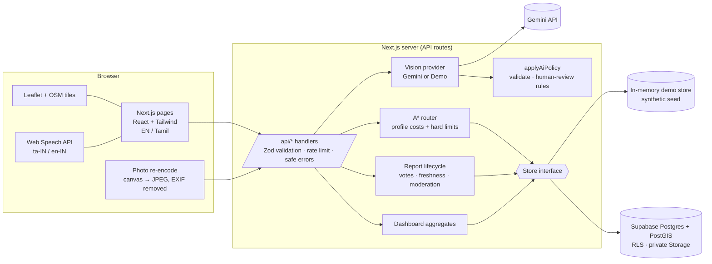

# NammaPath AI

**Mobility-aware pedestrian routes from AI-assisted, community-verified barrier reports.**
Hackathon MVP for *“AI for Better Living & Smarter Communities”* · Pilot: a small block of Mylapore, Chennai · Tamil + English.

> ⚠️ **All map data and seeded reports in this repository are synthetic demonstration data.** They are labelled `origin: "synthetic_demo"` everywhere (API, database, UI badges) and must not be presented as verified local conditions.

---

## Contents

1. [What it does](#what-it-does)
2. [Quick start (no API keys needed)](#quick-start-no-api-keys-needed)
3. [Environment variables](#environment-variables)
4. [Configure the AI provider (Gemini)](#configure-the-ai-provider-gemini)
5. [Configure Supabase](#configure-supabase)
6. [Deploy](#deploy)
7. [Demo mode — what's real and what isn't](#demo-mode--whats-real-and-what-isnt)
8. [Architecture](#architecture)
9. [How routing works](#how-routing-works)
10. [Verification policy](#verification-policy)
11. [API reference](#api-reference)
12. [Tests](#tests)
13. [Existing solutions and our differentiation](#existing-solutions-and-our-differentiation)
14. [Privacy, safety and security](#privacy-safety-and-security)
15. [Limitations and future work](#limitations-and-future-work)
16. [Judge summary & 3-minute demo script](#judge-summary--3-minute-demo-script)

---

## What it does

```
choose start + destination → choose a mobility profile → compare "shortest" vs "best match"
→ see reported barriers, reasons and uncertainty → photograph a new barrier → AI suggests a
category → you confirm or correct it → report stored as PENDING → neighbours confirm / dispute /
mark fixed → routes update
```

| Page | Path | What's there |
|---|---|---|
| Landing | `/` | Problem, how it works, feature cards, verification lifecycle, honest "what we don't claim" |
| Route map | `/map` | Start/destination (or geolocation), 4 mobility profiles, Leaflet map with status-coded barrier markers, two route options with reasons, data-confidence score, uncertainties, spoken directions (EN/TA), **data-gap missions**, caregiver share link |
| Mobility needs | `/preferences` | The 4 profiles with the exact routing rules and limitations of each; stored only on the device |
| Report a barrier | `/report` | Photo (camera or file, EXIF stripped client-side) → AI classification → confirm/correct → map location → category/severity → **Tamil/English voice description** → submit. Works fully manually when AI is unavailable |
| Community reports | `/reports` | Every report with status, severity, AI confidence, freshness; "Still there / Not accurate / It's fixed" actions; reporter can correct their own pending classification |
| Moderator console | `/moderate` | PIN-protected; set any status with a logged note; full status history |
| Dashboard | `/dashboard` | Totals, category frequency, hotspots by footpath segment, weekly trend (with table view), recently updated, stale reports needing re-verification, AI-correction stats, **civic complaint summary generator** |

## Quick start (no API keys needed)

Requirements: **Node.js 20+** (tested on 22) and npm.

```bash
git clone <your-repo> nammapath-ai && cd nammapath-ai
npm install
npm run dev          # http://localhost:3000
```

That's it — the app runs in **demo mode**: a seeded in-memory store and a deterministic, clearly-labelled demo "AI".

Production build:

```bash
npm run build
npm start            # http://localhost:3000
```

Other commands:

| Command | What it does |
|---|---|
| `npm test` | Unit + API tests (Vitest) |
| `npm run test:e2e` | Browser tests (Playwright, desktop + mobile). First time: `npx playwright install chromium` |
| `npm run typecheck` | TypeScript, no emit |
| `npm run seed:sql` | Regenerate `supabase/seed.sql` from `src/lib/seed.ts` (fresh timestamps) |
| `npm run screenshots` | Full-page screenshots of every page into `./screenshots` (needs a running server on :3100) |

## Environment variables

Copy `.env.example` to `.env.local`. **Everything is optional.**

| Variable | Needed for | Notes |
|---|---|---|
| `GEMINI_API_KEY` | Real photo classification | Server-side only. Without it → demo predictions |
| `GEMINI_MODEL` | Optional | Default `gemini-2.5-flash` |
| `SUPABASE_URL` | Persistent database | Project URL |
| `SUPABASE_SERVICE_ROLE_KEY` | Persistent database | **Server-side only — never prefix with `NEXT_PUBLIC_`** |
| `SUPABASE_PHOTO_BUCKET` | Photo storage | Default `report-photos` (private bucket created by the migration) |
| `MODERATOR_TOKEN` | Moderator console | In demo mode (no Supabase) the PIN defaults to `demo-moderator`. **With Supabase configured and no token set, moderation is disabled.** |
| `RATE_LIMIT_PER_MINUTE` | Abuse prevention | Per IP, for AI classification and report creation. Default 12 |

No variable is exposed to the browser. `/api/status` reports only *which* integrations are live.

## Configure the AI provider (Gemini)

1. Create a key at **Google AI Studio → https://aistudio.google.com/app/apikey**.
2. Put it in `.env.local` as `GEMINI_API_KEY=...` and restart the server.
3. The header chip changes from "AI: demo mode" to "AI: live".

How it's called (`src/lib/ai/gemini.ts`): REST `generateContent` with the image inline, `responseMimeType: application/json` and a `responseSchema`, temperature 0.1, 20-second timeout. The prompt (`src/lib/ai/prompt.ts`) restricts the model to visible evidence, forbids identifying people or inferring health conditions, and forbids claiming a route is safe.

Every response then goes through `applyAiPolicy` (`src/lib/ai/index.ts`): Zod validation → confidence < 0.6, "other" and "no barrier visible" force **human review** → any "the route is safe/accessible" claim is stripped. If the model fails or returns garbage, the API returns `fallback: "manual"` and the form continues manually.

To use a different vision model, implement the `VisionProvider` interface (`classify(image) → unknown`) and return it from `getVisionProvider()`.

## Configure Supabase

1. Create a project at https://supabase.com.
2. **SQL editor → run** `supabase/migrations/20261014000000_init.sql`. It creates:
   - `pedestrian_nodes`, `pedestrian_segments` (graph, PostGIS `geography` + GIST index)
   - `barrier_reports` (AI prediction stored separately from the user-confirmed category; PostGIS point; indexes on status, segment, category)
   - `report_votes`, `report_status_history` (audit trail)
   - `moderators` + `is_moderator()` for a future Supabase-Auth moderator login
   - Row Level Security on every table: anon can **read** map data only; **no anon write policies** — all writes go through the Next.js API with the service-role key
   - a **private** `report-photos` storage bucket (5 MB, JPEG/PNG/WebP only); photos are served via 5-minute signed URLs
3. Seed the demo pilot: `npm run seed:sql`, then run `supabase/seed.sql` in the SQL editor (every row is `synthetic_demo`).
4. Project Settings → API: copy the URL and **service_role** key into `.env.local` (`SUPABASE_URL`, `SUPABASE_SERVICE_ROLE_KEY`) and set `MODERATOR_TOKEN`.
5. Restart. The banner shows "Data: database".

If the database tables are empty, the graph falls back to the seeded synthetic graph. If the database is unreachable, API routes return `503` with a safe message and the UI shows a retry state.

> The migration and seed were executed successfully against PostgreSQL 16 + PostGIS 3 with stub `auth`/`storage` schemas (and re-run to confirm they're idempotent). The `SupabaseStore` adapter has **not** been run against a live Supabase project in this environment.

## Deploy

**Vercel (recommended):** import the repo → add the environment variables above → deploy. No build settings needed.

**Any Node host:** `npm ci && npm run build && npm start` (set `PORT` if needed).

Notes:
- Without Supabase, the in-memory store is **per server instance** and resets on restart — fine for a live demo, not for real use. On serverless hosts each instance has its own copy.
- Rate limiting is in-memory per instance; put a shared limiter (e.g. Upstash/Redis) in front for production.
- Map tiles come from `tile.openstreetmap.org`; for real traffic follow the [OSM tile usage policy](https://operations.osmfoundation.org/policies/tiles/) or use a tile provider.

## Demo mode — what's real and what isn't

| Thing | Without keys | With keys |
|---|---|---|
| Pedestrian graph & seeded reports | **Synthetic**, labelled everywhere | Synthetic until you replace them with surveyed data (`origin = verified_survey`) |
| Routing (A*), profiles, explanations, uncertainty, missions | **Real** algorithm on the seeded graph | Same |
| Report creation, voting, status rules, moderation, dashboard | **Real** logic, in-memory store | Persistent in Supabase |
| Photo classification | **Simulated**: deterministic, derived from file name keywords or a hash of the bytes; banner says "No AI model looked at your photo"; ~1 in 4 images gets low confidence to show the review path | **Real** Gemini inference |
| Voice input / spoken directions | Browser Web Speech API where supported (Tamil availability depends on the device); typed/visual fallback otherwise | Same |

Demo sample images on `/report` are computer-drawn illustrations, not real places.

## Architecture



Key files:

```
src/lib/routing.ts        A* + profile cost model + explanations, uncertainty, missions
src/lib/reports.ts        verification policy, freshness/half-life, routing effect
src/lib/profiles.ts       the 4 mobility profiles (rules shown verbatim in the UI)
src/lib/categories.ts     categories (EN/TA), half-lives, keyword matching for voice
src/lib/ai/*              provider abstraction, Gemini REST, demo provider, prompt, policy
src/lib/store/*           Store interface, MemoryStore, SupabaseStore
src/lib/seed.ts           synthetic pilot graph + reports (single source for seed.sql)
src/lib/dashboard.ts      aggregates + civic summary text
src/app/api/**            REST endpoints
src/app/**/               pages (map, report, reports, moderate, dashboard, preferences)
supabase/migrations/      schema, indexes, RLS, private bucket
tests/unit, tests/e2e     Vitest and Playwright
```

## How routing works

The pilot is an explicit pedestrian graph: **nodes** (junctions, entrances, landmarks, transit stops) and **segments** (footpaths and crossings) with: length (from geometry), steps (`none/some/stairs_only/unknown`), ramp, surface, width, slope, safe crossing, tactile paving, handrail, verification level, origin and last-update time. Barrier reports are snapped to the nearest segment (≤ 60 m).

`cost = length × attribute factors + barrier penalties`, all factors ≥ 1 and penalties ≥ 0, so straight-line distance is an admissible A* heuristic.

| Profile | Hard limits (segment removed) | Main penalties |
|---|---|---|
| Wheelchair / step-free | known steps or stairs; missing ramp; slope > 8 %; width < 0.9 m; **confirmed, fresh** stairs, impassable or severe blocked-ramp reports | unknown steps ×3, unknown ramp ×1.5, unknown surface ×2, poor surface ×2.5, unknown width ×1.2, unverified ×1.25 |
| Walking aid | confirmed impassable reports | stairs ×2.2 with handrail / ×4 without; poor surface ×3; unknown surface ×1.8 |
| General | confirmed impassable reports | distance, light barrier penalties |
| Low-vision guidance | confirmed impassable reports | crossing without signal ×5, unknown crossing ×2.5, no tactile ×1.3, trip hazards ×1.2 |

Report effect: **confirmed & fresh** → full penalty / possible hard block; **pending** → 50 % penalty × freshness weight; **disputed** → 25 %; **stale** confirmed → treated as uncertain; **resolved** → ignored. A single unverified report never blocks a segment.

Each search returns **Shortest** (distance only, avoiding confirmed impassable) and **Best match** (profile cost). For each: distance (no invented walking times), barriers, reasons ("Avoids Footbridge over Main Road (stairs only)", "+802 m / 109 %"), a **claim** (`supported` / `uncertain` / doesn't meet constraints), **data confidence** (share of length with verified-or-community, recent data and no open uncertain reports), uncertainties, step-by-step directions (EN/TA), and **verification missions** — the specific data gaps on that route a volunteer could check. If no route satisfies the hard limits, the API says so and lists the blockers instead of inventing one.

## Verification policy

Shown on `/reports` and enforced in `src/lib/reports.ts`:

- Every new report starts **Pending** — even if the AI is 99 % confident.
- **Confirmed**: 2 independent "still there" votes (the reporter's own vote doesn't count), or a moderator.
- **Disputed**: ≥ 2 "not accurate" votes that are ≥ confirmations, or a moderator.
- **Resolved**: 2 "it's fixed" votes, or a moderator. A later "still there" re-opens it as Pending.
- One vote per action per anonymous device id (counted since the last status change).
- **Freshness**: each category has a half-life — flooding 2 days, blocked ramp 10, debris 14, other 21, broken footpath 90, stairs never. After one half-life a report shows "may be outdated — please re-verify" and routing treats it as uncertain.
- Every status change is stored in `report_status_history` with actor (`system/community/moderator`) and note.

## API reference

All JSON. Errors: `{ "error": "<safe message>" }` with 400 / 401 / 403 / 404 / 409 / 413 / 415 / 429 / 502 / 503.

| Method | Path | Body / query | Notes |
|---|---|---|---|
| GET | `/api/status` | — | AI and database mode (no secrets) |
| GET | `/api/graph` | — | Nodes + segments |
| GET | `/api/barriers` | `?status=pending,confirmed&category=stairs&viewer=<clientId>` | Device ids are never returned |
| POST | `/api/barriers` | `{lat,lng,category,severity,description?,clientId,language,ai?,photo?}` | Always created as `pending`; rate-limited; photo ≤ 5 MB JPEG/PNG/WebP checked by magic bytes |
| GET | `/api/barriers/:id` | `?viewer=<clientId>` | |
| POST | `/api/barriers/:id/actions` | `{action: confirm\|dispute\|resolve, clientId}` | 409 for duplicate/own vote |
| PATCH | `/api/barriers/:id/classification` | `{category,severity,clientId}` | Reporter only, while pending |
| GET | `/api/barriers/:id/photo` | — | 5-minute signed URL (Supabase) |
| POST | `/api/classify` | multipart `photo`, `description?` | Returns `{prediction, provider, model, isDemo, policyNotes}`; photo not stored |
| POST | `/api/route` | `{from,to,profile}` | `RouteResult` |
| GET | `/api/dashboard` | — | Aggregates from the store |
| GET | `/api/moderate` | header `x-moderator-token` | Token check |
| POST | `/api/moderate/:id` | header `x-moderator-token`; `{status,note}` | |

## Tests

```bash
npm test                 # 39 unit/API tests
npm run build && npm run test:e2e   # 16 Playwright tests (8 scenarios × desktop + Pixel 7)
```

Coverage of the required scenarios:

| Requirement | Test |
|---|---|
| AI response validation & low-confidence handling | `tests/unit/ai.test.ts` |
| Invalid file rejection | `tests/unit/upload.test.ts`, `api.test.ts` (415 on fake JPEG) |
| Barrier creation & status transitions | `tests/unit/reports.test.ts` |
| Confirmed stairs block a step-free route | `routing.test.ts` › "wheelchair avoids the confirmed stairs-only footbridge…" |
| Unknown segment handling | `routing.test.ts` › "treats a segment with unknown steps as uncertain…" |
| Longer route chosen when it better fits | `routing.test.ts` › "selects a longer route…" |
| No route available | `routing.test.ts` › "returns a no-route explanation…", E2E |
| Empty database & API failure states | `reports.test.ts` (empty dashboard), `api.test.ts` (503 without stack traces, empty list) |
| Responsive UI & accessible forms | `tests/e2e/app.spec.ts` (error summary focus, skip link, language switch, no horizontal scroll on mobile) |

Results in the build environment: **39/39 unit tests passed, 16/16 E2E tests passed, `next build` and `tsc` clean.**

## Existing solutions and our differentiation

We are **not** the first accessibility map or the first AI accessibility project. Some relevant, evidence-backed comparisons:

| Product | What it does (per sources) | Places info | Pedestrian barriers | User reports | Verification | Mobility-aware routing |
|---|---|---|---|---|---|---|
| **Google Maps** | "Wheelchair accessible" transit routes since March 2018 ([Google](https://blog.google/products/maps/introducing-wheelchair-accessible-routes-transit-navigation/)); Accessible Places icons for entrances, seating, restrooms, parking, contributed by Local Guides and businesses, from May 2020 ([Google](https://blog.google/products/maps/wheelchair-accessible-places-google-maps/)); stair-free walking routes "wherever data is available", announced Oct 2023 ([report](https://www.siasat.com/google-unveils-new-accessibility-tools-for-maps-search-chrome-2728776/)) | ✔ | not described in these sources | ✔ (place attributes) | not described | ✔ transit + stair-free walking |
| **AccessNow** | Crowdsourced accessibility information about *places* worldwide; users rate places Accessible / Partially / Not accessible and add tags ([FAQ](https://accessnow.com/faq/), [MapMission guide](https://accessnow.com/mapmissionguide/)) | ✔ | — | ✔ | not described | routing not mentioned |
| **Project Sidewalk** (UW) | Volunteers virtually audit sidewalks in Google Street View, labelling curb ramps, missing ramps, obstacles and surface problems; a validation mini-game checks others' labels; deployed in D.C., Seattle and others ([UW News](https://washington.edu/news/2019/04/18/project-sidewalk)) | — | ✔ | ✔ (remote) | ✔ peer validation | no — produces data for routing tools |
| **AccessMap** (UW Taskar Center) | Personalised pedestrian routing, e.g. limit incline to 5 % and require curb ramps, on OpenSidewalks data built with ML + human vetting; Washington State coverage ([UW CREATE](https://create.uw.edu/taskar-project-helps-pedestrians-find-accessible-routes-all-over-washington-state/)) | — | ✔ (infrastructure) | — | human vetting | ✔ |

**Our proposed differentiation** is a *locally focused combination* rather than any single new capability:

1. **On-the-ground photo reports with AI-assisted classification** that the reporter must confirm, with confidence and uncertainty shown — the AI prediction and the human classification are stored separately.
2. **Time-aware, community-verified barriers** — status lifecycle plus category-specific freshness (monsoon flooding goes stale in 2 days; stairs never), so temporary obstacles don't silently persist.
3. **Routing that consumes those reports and is explicit about uncertainty** — unknown data is never called accessible, every route has a data-confidence score, and no-route cases are explained.
4. **Turning data gaps into action** — each route lists "verification missions", and dashboard hotspots produce a ready-to-paste civic complaint summary (nothing is auto-submitted).
5. **Tamil + English** UI, voice description and spoken directions, for a Chennai pilot.

## Privacy, safety and security

- No accounts, names, phone numbers, diagnoses or medical data. Mobility profile is stored only in the browser.
- Anonymous random device id (localStorage) used only to stop duplicate votes; never returned by the API.
- Photos are re-encoded in the browser (max 1280 px JPEG via canvas), which drops EXIF including GPS, and the original file is never uploaded. Server re-validates by magic bytes and size. Stored in a **private** bucket; served via short-lived signed URLs. The classify endpoint does not store photos.
- API keys and service-role credentials live only in server environment variables.
- Zod validation on every input, request-size limits, per-IP rate limits on AI and report creation, safe error messages (no stack traces), security headers (`nosniff`, `Referrer-Policy`, `Permissions-Policy`).
- AI is instructed not to identify people or infer health conditions; low-confidence results require human review; claims of route safety are stripped.
- Moderation requires a server-side token; all moderator decisions are logged.

## Limitations and future work

**Current limitations**
- The pilot graph is small and **synthetic**. Real use needs surveyed footpath data (e.g. imported from OpenStreetMap `footway`/`kerb`/`incline` tags, a field audit, or an OpenSidewalks-style dataset) marked `verified_survey`.
- Start/destination are limited to named places in the pilot; geolocation snaps to the nearest named place within 500 m.
- In-memory demo store resets on restart and is per-instance; in-memory rate limiting.
- Moderator auth is a shared token, not per-user accounts (the schema includes a `moderators` table for Supabase Auth).
- Anonymous device ids can be reset, so vote thresholds deter but don't prevent determined abuse.
- Tamil speech recognition/synthesis depends on the browser and device; a typed/visual fallback is always available.
- The demo AI provider is not a model. Real classification quality with Gemini has not been benchmarked on Chennai footpath photos.
- `SupabaseStore` not exercised against a live Supabase project in this environment (schema + seed verified on Postgres/PostGIS).
- Walking times are intentionally not estimated.

**Next steps**
- Import OSM sidewalk data for the ward and run a volunteer field audit; evaluate AI precision/recall against volunteer labels.
- Supabase Auth for moderators and optional volunteer accounts with reputation weighting.
- Free-point routing (snap any address to the graph), elevation data for slope.
- Offline-capable PWA for low-connectivity reporting.
- Export hotspots as CSV/GeoJSON for the municipal corporation and track resolution times.

## Judge summary & 3-minute demo script

See **[docs/JUDGES.md](docs/JUDGES.md)** for the one-page judge summary, the 3-minute demo script and a rubric self-assessment.
